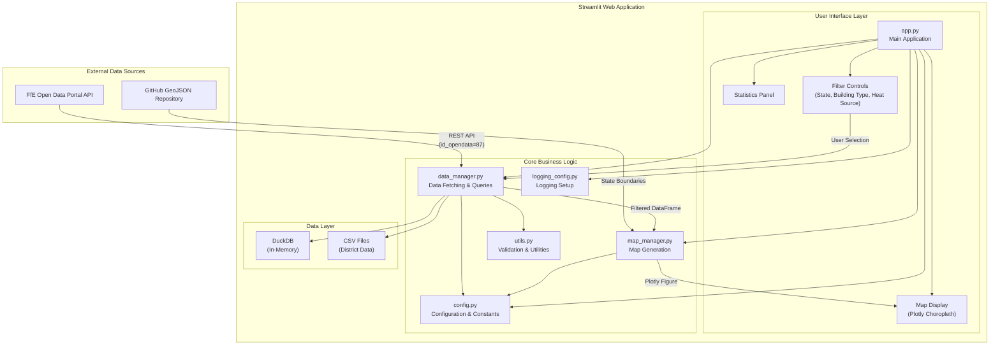
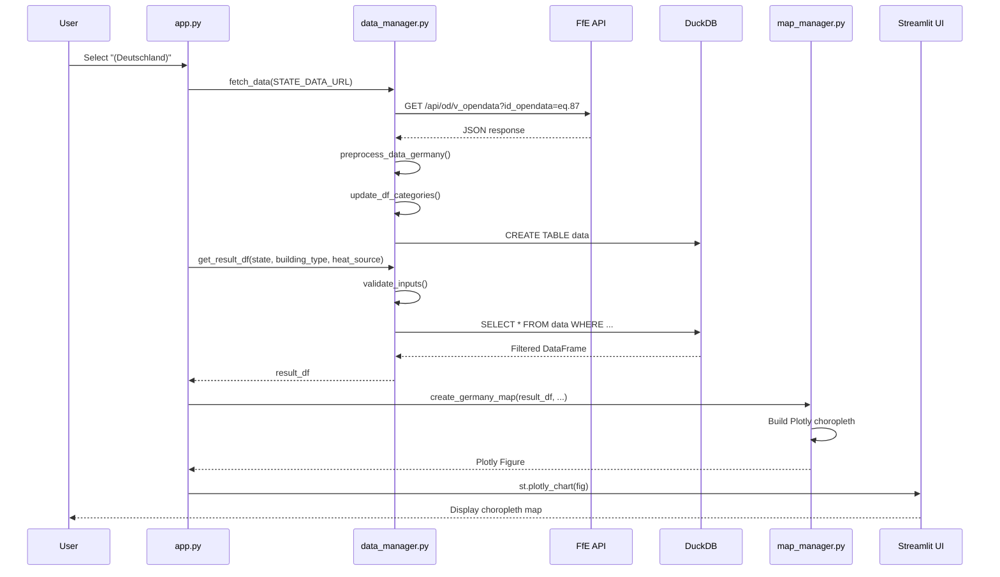
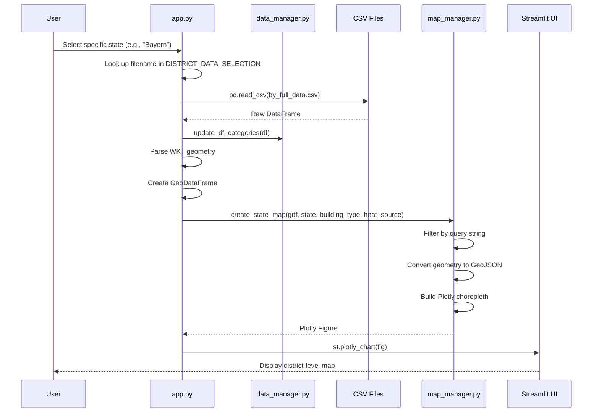

# Architecture Overview

This document describes the system architecture of the Heat Pump Potentials Germany application.

## System Overview Diagram



## Data Flow

The application supports two primary data flows depending on the user's geographic selection:

### Germany-Level View (Deutschland)



### State-Level View (Individual State)



### Data Flow Pipeline: API → Transform → DuckDB → Plotly

The data pipeline follows a four-stage process that transforms raw external data into interactive visualizations:

#### Stage 1: API Data Acquisition

For Germany-level views, data is fetched from the FfE Open Data Portal REST API:

- **Endpoint**: `https://opendata.ffe.de/api/od/v_opendata?id_opendata=eq.87`
- **Response**: JSON array containing heat pump suitability data aggregated at the state level
- **Fields**: State identifier, building type code, heat source code, suitability value (0.0-1.0)

For state-level views, pre-processed CSV files are loaded from local storage:

- **Location**: `webapp/data/districts/{state_abbrev}_full_data.csv`
- **Format**: CSV with district-level data including WKT geometry strings

#### Stage 2: Data Transformation

Raw data undergoes several transformation steps:

1. **Preprocessing** (`preprocess_data_germany`):
   - Extracts relevant fields from nested JSON structure
   - Normalizes column names to consistent format
   - Converts numeric fields to appropriate data types

2. **Category Mapping** (`update_df_categories`):
   - Replaces numeric building type codes with human-readable labels
   - Replaces heat source codes with descriptive names
   - Maps state abbreviations to full names

3. **Geometry Processing** (state-level only):
   - Parses WKT (Well-Known Text) geometry strings using Shapely
   - Creates GeoPandas GeoDataFrame with proper CRS (coordinate reference system)

#### Stage 3: DuckDB Query Engine

Filtered data retrieval uses DuckDB for performant analytical queries:

1. **Table Creation**: Transformed DataFrame is registered as an in-memory DuckDB table
2. **Parameterized Queries**: User selections (building type, heat source, state) are passed as parameters
3. **Input Validation**: All parameters are validated against allowed values before query execution
4. **Result Extraction**: Query results are returned as a Pandas DataFrame

Example query pattern:
```sql
SELECT federal_state, building_type, heat_source, value
FROM data
WHERE building_type = ? AND heat_source = ?
```

#### Stage 4: Plotly Visualization

The filtered DataFrame is rendered as an interactive choropleth map:

1. **Geographic Boundaries**:
   - Germany view: GeoJSON fetched from external URL for state boundaries
   - State view: Geometry extracted from GeoDataFrame district polygons

2. **Map Construction** (`create_germany_map` / `create_state_map`):
   - Joins suitability values to geographic features
   - Applies color scale (RdYlGn: red=low, green=high suitability)
   - Configures hover tooltips with district/state name and percentage

3. **Rendering**: Plotly figure is embedded in Streamlit UI using `st.plotly_chart()`

## Module Descriptions

### `webapp/app.py`
Main Streamlit application entry point. Responsibilities:
- Initialize session state for filter selections
- Orchestrate data loading based on geographic scope
- Render the three-column filter layout
- Display the choropleth map and statistics panel
- Handle errors with user-friendly messages

### `webapp/config.py`
Central configuration module. Contains:
- API endpoint URLs (FfE Open Data Portal)
- GeoJSON source URLs (state and district boundaries)
- List of 15 German federal states
- File path mappings for district CSV files
- Geographic center coordinates and zoom levels per state
- Category mappings (building types, heat sources)

### `webapp/data_manager.py`
Data fetching and query module. Provides:
- `fetch_data(url)`: Fetch JSON from FfE API
- `preprocess_data_germany(raw_json)`: Transform API response to DataFrame
- `update_df_categories(df)`: Apply human-readable category labels
- `get_result_df(state, building_type, heat_source)`: Query filtered data via DuckDB

### `webapp/map_manager.py`
Map generation module. Provides:
- `set_geographical_values(selected_state)`: Get lat/lon/zoom for state
- `create_germany_map(...)`: Generate state-level choropleth
- `create_state_map(...)`: Generate district-level choropleth

### `webapp/utils.py`
Shared utility functions. Contains:
- Input validation against allowed values
- `InputValidationError` exception class
- `validate_inputs()`: Validates building type, heat source, and state

### `webapp/logging_config.py`
Logging configuration module. Provides:
- `setup_logging()`: Configure logger with console handler
- Timestamp formatting for log messages
- Handler deduplication for Streamlit reruns

## File Structure

```
heat-pump-potentials-germany/
├── webapp/
│   ├── app.py              # Main Streamlit application
│   ├── config.py           # Configuration and constants
│   ├── data_manager.py     # Data fetching and DuckDB queries
│   ├── map_manager.py      # Plotly map generation
│   ├── utils.py            # Validation utilities
│   ├── logging_config.py   # Logging setup
│   └── data/
│       └── districts/      # Pre-computed CSV files (16 states)
│           ├── bw_full_data.csv
│           ├── by_full_data.csv
│           └── ...
├── tests/
│   ├── __init__.py
│   └── unit/
│       ├── __init__.py
│       └── test_sql_injection.py
├── notebooks/
│   └── district_map_generation.ipynb
├── docs/
│   └── ARCHITECTURE.md     # This file
├── pyproject.toml          # Project dependencies and tool config
└── README.md               # Project documentation
```

## Security Considerations

1. **SQL Injection Prevention**: All database queries use parameterized placeholders (`?`) instead of string interpolation. User inputs are validated against allowed values before query execution.

2. **Input Validation**: The `validate_inputs()` function checks all user-provided values against predefined allowed lists before any database operation.

3. **Error Handling**: Exceptions are caught and logged, with user-friendly error messages displayed via `st.error()`.

## Technology Stack

| Component | Technology | Purpose |
|-----------|------------|---------|
| Web Framework | Streamlit | Interactive UI |
| Data Processing | Pandas, GeoPandas | DataFrame operations |
| Database | DuckDB (in-memory) | Fast analytical queries |
| Visualization | Plotly Express | Choropleth maps |
| Geometry | Shapely | WKT parsing |
| HTTP Client | Requests | API calls |
| Testing | pytest | Unit tests |
| Linting | ruff | Code quality |
| Type Checking | mypy | Static analysis |
